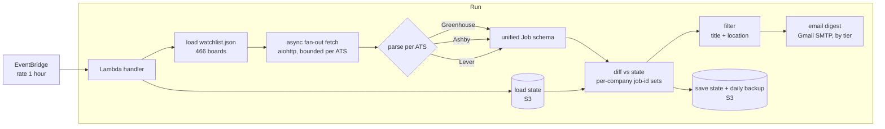

# ATS Watcher

Hourly new-job monitor for **466 US tech companies** whose applicant-tracking
systems (Greenhouse / Ashby / Lever) expose a public JSON board. New roles that
match a target profile reach the inbox **within the hour** — before applicant
counts pile up. It optimizes for *speed*: no JD full-text crawl, no per-job LLM
call, just a cheap hourly diff.

## Problem

Good roles at fast-moving companies collect hundreds of applicants within a day
of posting. Job boards and email alerts lag by hours to days and bury matches in
noise. The goal: detect a genuinely *new* backend/SWE posting across hundreds of
company boards and deliver only the matches, fast enough to apply early — on a
budget of roughly one Lambda invocation per hour.

## Architecture



Per run: load the bundled watchlist and prior state → fan out and fetch every
board concurrently → parse each ATS into one job schema → diff job-ids against
state to find genuinely new postings → filter by title/location → email the
matches grouped by tier → persist state.

| Module | Responsibility |
|---|---|
| `watcher/fetchers.py` | async fan-out (`aiohttp`) + pure per-ATS parsers (Greenhouse / Ashby / Lever) into one job schema |
| `watcher/differ.py` | diff current job-ids vs stored state; first-run seeding; empty/fail-streak bookkeeping |
| `watcher/filters.py` | pure title + location rules (include/exclude, level-II targeting) |
| `watcher/storage.py` | state in S3 (deployed) or a local file (dev), with a daily backup |
| `watcher/notifier.py` | Gmail SMTP send (stdlib `smtplib`), grouped by tier |
| `watcher/lambda_function.py` | handler: diff cycle, one-off backlog sweep, weekly health report |
| `discovery/discover_slugs.py` | resolve company names → ATS board slugs to build `watchlist.json` |
| `trigger.sh` | operator CLI against the deployed function (status / preview / backlog / run / logs) |

## Key design decisions & trade-offs

- **Diff, not scrape-all.** State stores a per-company set of seen job-ids; only
  ids that weren't there last run are notified. *Trade-off:* the first run seeds
  state silently (no email), so the existing backlog is never mailed — surfaced
  on demand via the `backlog` sweep instead.
- **Confirm-before-trusting an empty board** (`EMPTY_CONFIRM_RUNS = 3`). A board
  that returns zero jobs for one run is usually a transient blip, not a real
  emptying. Requiring several consecutive empty reads avoids spurious "role
  removed" churn. *Trade-off:* a genuine emptying is accepted a few hours late.
- **Don't commit state on delivery failure.** If the email send fails, state is
  left unwritten so the next run re-detects and resends the same jobs rather
  than marking them seen and dropping them silently. *Trade-off:* one repeated
  fetch cycle; never a lost notification.
- **Gmail SMTP over a third-party email API.** Uses stdlib `smtplib` — zero
  email dependencies to bundle into the Lambda zip. *Trade-off:* subject to
  Gmail's daily send limits (fine at this volume).
- **Speed over scoring.** No JD full-text fetch and no LLM call per job keeps a
  run cheap and sub-minute. *Trade-off:* filtering is regex title/location, not
  semantic — ambiguous titles are kept and flagged `needs_review` rather than
  dropped.

### Parsing three ATS formats

Each ATS exposes a different public JSON shape; `fetchers.py` maps all three
into one schema (`job_id, title, company, tier, location, url, posted_at`):

| ATS | Endpoint | Key fields |
|---|---|---|
| Greenhouse | `…/boards/{slug}/jobs?content=false` | `id`, `title`, `location.name`, `absolute_url`, `updated_at` |
| Ashby | posting-api `job-board/{slug}` | `id`, `title`, `location` + `secondaryLocations[]`, `jobUrl`, `publishedAt` |
| Lever | `…/v0/postings/{slug}?mode=json` | `id`, `text`, `categories.location`, `hostedUrl`, `createdAt` (epoch ms) |

### Dedup, rate-limiting, retries

- **Dedup:** job-ids are deduped against the per-company set in state, so a role
  is mailed exactly once across its lifetime on the board.
- **Rate-limiting:** the async fan-out bounds concurrency per ATS domain rather
  than hammering a single host with 466 simultaneous requests.
- **Retries & health:** per-company fetch failures increment a `fail_streak`;
  companies failing `>= 24` consecutive runs are surfaced as `chronic_failures`
  in the weekly report so dead slugs can be pruned.

## How to run

Local dev (file state, prints instead of emailing):

```bash
pip install -r requirements.txt
python3 -m watcher.lambda_function --local --once
```

Tests (pure parsers + filters, no network):

```bash
python3 tests/test_filters.py
python3 tests/test_fetchers.py
```

Rebuild the watchlist from a seed CSV (`company,slug_hint,tier,category,notes`):

```bash
python3 discovery/discover_slugs.py --seed companies_seed.csv
```

Deploy to AWS Lambda + EventBridge: see [`DEPLOY.md`](DEPLOY.md). Day-to-day
operation uses `./trigger.sh` (`status` / `preview` / `backlog` / `run` / `logs`).

## Results / metrics

- **466 boards** monitored — Tier A 234 / B 216 / C 16.
- **Cadence:** EventBridge `rate(1 hour)`; new matching roles emailed within the hour.
- **Runtime:** AWS Lambda, `python3.12`, 512 MB / 300 s timeout, state in S3.
- **Cost:** TODO — hourly invocation + S3; well within free tier in practice (confirm exact monthly figure).
- **Delivery:** matches grouped by tier; weekly health report on Sundays (once per ISO week).

## Notes

Email recipients and credentials are supplied entirely via environment variables
(`.env.example`); nothing personal is committed. `watchlist.json` is a snapshot
of resolved public company boards.
